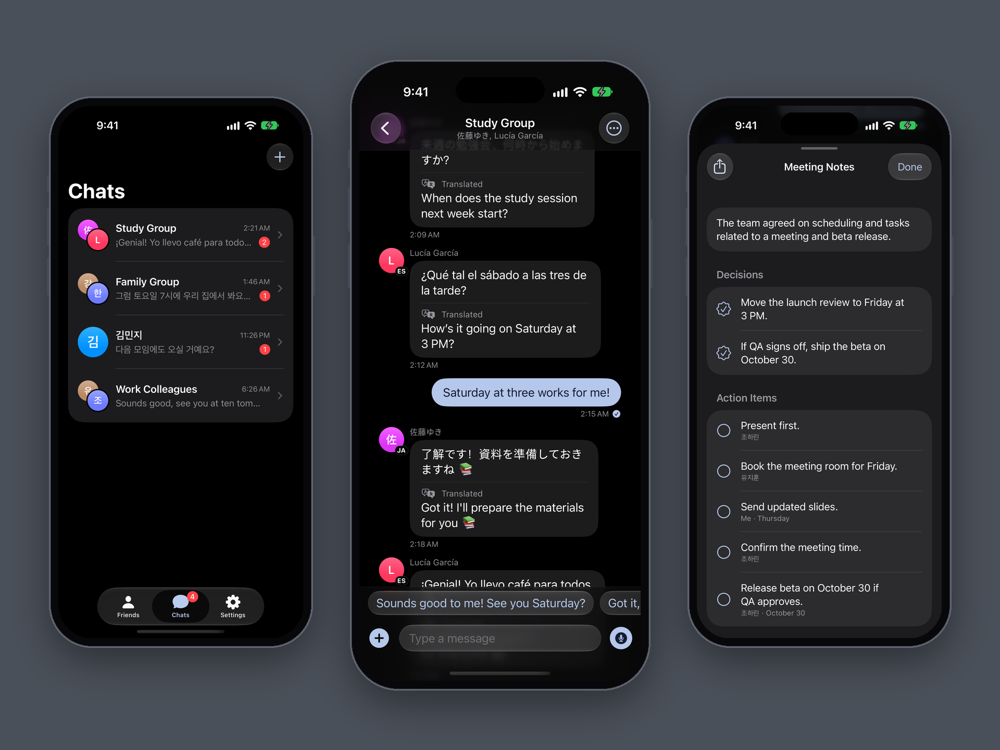
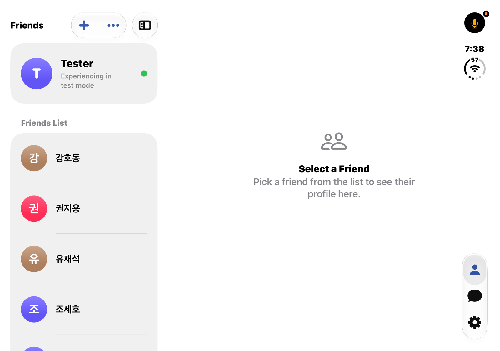
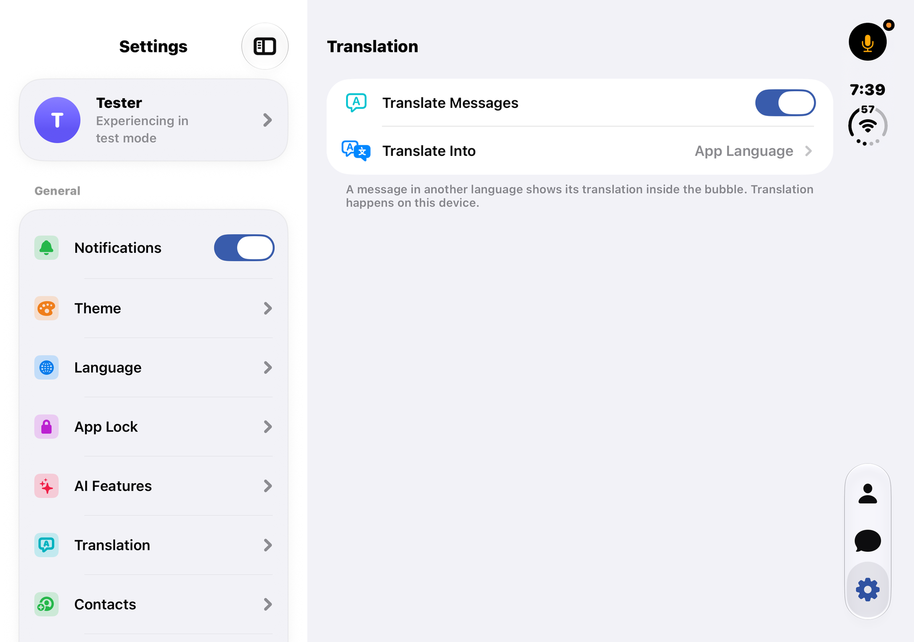

# L!NK

**Messaging without borders.**

You write in Korean, they answer in Japanese, and you both read your own language. L!NK is a messenger anyone can pick up, older people included, with the translation inside every message.

- **Translation in the bubble**, on the device, across seven languages.
- **On-device AI**: summaries, meeting notes, reply suggestions, and search by meaning across languages.
- **Easy for everyone**: large text, VoiceOver, six app languages, Siri.
- **No server, no account**: tap **Try Test Mode** and chat with sample friends.

## iPhone Duo

Open, the chat list stays beside the conversation. These are from a real iPhone Duo.

| Friends | Settings |
| --- | --- |
|  |  |

## Try it

Open `TalkMVP.xcodeproj` in Xcode 27 or later, run it on iOS 26 or later, and tap **Try Test Mode**.

Built with SwiftUI, SwiftData, Foundation Models, and the Translation and Speech frameworks. More in [docs/ENGINEERING.md](docs/ENGINEERING.md) and [docs/screenshots](docs/screenshots).

## About

Designed and built solo by David Song. Questions and feedback are welcome through [@mobssy](https://github.com/mobssy).

## License

**All rights reserved, worldwide. This is not open source.**

Copyright © 2025–2026 David Song. This repository is public only so the work can be seen. No permission is given to anyone, in any country, to use, copy, modify, or distribute the code, the design, the icon, or the images, in whole or in part, including as training data for AI models, without prior written permission. See [LICENSE](LICENSE).
